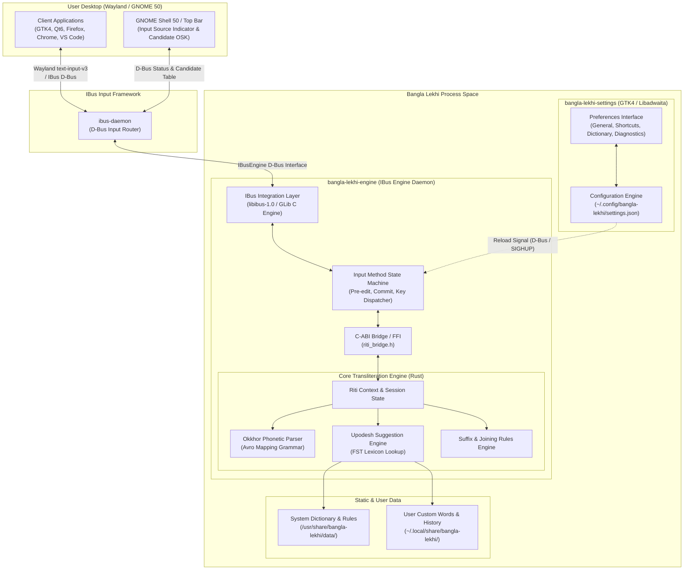
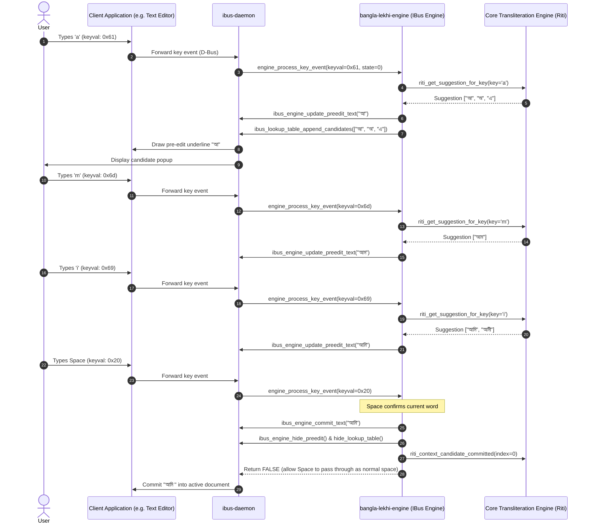

# Architecture Specification: Bangla Lekhi

**Project:** Bangla Lekhi  
**Document:** `docs/ARCHITECTURE.md`  
**Date:** 2026-10-24  
**Author:** Lead Linux Desktop & Input-Method Engineer  
**Status:** Completed (Milestone 0)

---

## 1. System Overview

Bangla Lekhi is a native Linux Bengali phonetic input method built specifically for modern GNOME desktop environments running on Wayland. It integrates seamlessly into the system's Intelligent Input Bus (IBus) daemon, providing Avro-compatible phonetic typing across all GTK, Qt, Chromium, Firefox, Electron, and terminal applications.

### Design Goals
1. **Lightweight & High-Performance:** Ultra-low memory usage (< 15 MB total resident RAM), zero idle CPU consumption, and sub-millisecond typing latency.
2. **Native GNOME Integration:** Built directly with GLib/IBus and GTK4/Libadwaita; completely free of heavy runtimes (no Qt, Electron, or web containers).
3. **Privacy First:** 100% offline operation; no keystroke logging, telemetry, or external network calls.
4. **Resilient Typing Flow:** Deterministic Avro phonetic mapping with fast FST-based candidate suggestions, inline pre-edit fallback, and robust Wayland compatibility.

---

## 2. High-Level Architecture Diagram



---

## 3. Subsystem Breakdown

### 3.1 Component A — Core Phonetic Engine (`src/engine/`)
- **Technology:** Rust (reusing OpenBangla's `riti` core modules under MPL-2.0).
- **Responsibilities:**
  - Maintains phonetic composition buffer (`buffer: String`).
  - Converts Latin phonetic input strings into Bengali Unicode strings based on Avro rules via `okkhor`.
  - Computes candidate suggestions and rankings using the `upodesh` FST lexicon engine.
  - Handles Bengali orthographic rules: Kar signs, conjuncts (যুক্তাক্ষর), Hasanta, Reph, Khanda Ta (ৎ), Anusvara (ং), Chandrabindu (ঁ).
  - Handles user custom words and suffix joins (যেমন: "-গুলো", "-গুলোতে", "-দের").
- **Interface:** Exposes a clean, thread-safe C-ABI interface (`riti.h` / `riti_bridge.h`) compiled as a static library (`libriti.a`).

### 3.2 Component B — IBus Engine Process (`src/ibus/`)
- **Technology:** C / GLib / `libibus-1.0`.
- **Executable:** `/usr/lib/bangla-lekhi/bangla-lekhi-engine`
- **Responsibilities:**
  - Connects to `ibus-daemon` over session D-Bus and registers the `bangla-lekhi` engine.
  - Implements the `IBusEngineClass` virtual methods:
    - `process_key_event(engine, keyval, keycode, state)`
    - `focus_in(engine)` / `focus_out(engine)`
    - `reset(engine)`
    - `enable(engine)` / `disable(engine)`
    - `set_surrounding_text(...)`
    - `candidate_clicked(...)`
  - Manages the IBus Lookup Table (`IBusLookupTable`) for candidate popup suggestions.
  - Manages the IBus Pre-edit buffer (`ibus_engine_update_preedit_text`).
  - Commits composed Unicode text to client applications (`ibus_engine_commit_text`).
  - Handles the English/Bangla mode toggle key (`F12` default or user-defined shortcut) directly inside the engine process.

### 3.3 Component C — Candidate & Dictionary Engine (`src/dictionary/`)
- **System Lexicon:** Pre-compiled FST binary dictionary stored in `/usr/share/bangla-lekhi/data/dictionary.json` (compressed and fast to query).
- **Autocorrect Database:** Stored in `/usr/share/bangla-lekhi/data/autocorrect.json`.
- **User Dictionary:** Stored in `$XDG_DATA_HOME/bangla-lekhi/user_words.json`.
- **Latency Target:** Candidate lookup must complete in < 0.2 ms so key repeat and fast typing never stutter.

### 3.4 Component D — Settings Application (`src/settings/`)
- **Technology:** GTK4 + Libadwaita (`bangla-lekhi-settings`).
- **Responsibilities:**
  - Configure global toggle shortcut (e.g. `F12`, `Ctrl+Space`).
  - Configure candidate suggestion window (show/hide, horizontal vs vertical layout, maximum candidate count).
  - AutoCorrect toggle and custom word management (add/remove custom words).
  - Autostart preference toggle (manages `~/.config/autostart/bangla-lekhi.desktop`).
  - Diagnostic viewer (displays IBus status, version, session type, active profile).

### 3.5 Component E — Desktop Integration & Packaging (`packaging/`)
- **IBus Manifest:** `/usr/share/ibus/component/bangla-lekhi.xml`
- **Desktop Entry:** `/usr/share/applications/bangla-lekhi-settings.desktop`
- **Application Icon:** `/usr/share/icons/hicolor/scalable/apps/bangla-lekhi.svg`
- **Debian Package:** `bangla-lekhi_<version>_amd64.deb` containing binaries, data files, man page, copyright notices, and post-installation scripts.

---

## 4. Keystroke Processing Sequence

The sequence diagram below traces how a sequence of keystrokes (e.g., typing `a`, `m`, `i` -> "আমি") flows from a client application through IBus into Bangla Lekhi and back:



---

## 5. Composition & Navigation Rules

| Key Event | Composition Active? | Engine Action | Event Absorbed? |
|---|---|---|---|
| **Alphanumeric (`a`-`z`, `0`-`9`)** | No / Yes | Pass to phonetic transliterator; update pre-edit & candidates | **TRUE** (absorbed) |
| **`Backspace`** | Yes (buffer > 1 char) | Step back 1 char in buffer; update pre-edit | **TRUE** (absorbed) |
| **`Backspace`** | Yes (buffer == 1 char)| Clear buffer; hide pre-edit & candidate window | **TRUE** (absorbed) |
| **`Backspace`** | No | Do nothing (normal application deletion) | **FALSE** (passed) |
| **`Space`** | Yes | Commit selected candidate; allow space to pass | **FALSE** (commits + space) |
| **`Enter` / `Return`** | Yes | Commit selected candidate; close pre-edit | Configurable (TRUE/FALSE) |
| **`Escape`** | Yes | Discard composition buffer; clear pre-edit | **TRUE** (absorbed) |
| **`Down` / `Right` Arrow** | Yes (candidates shown) | Move candidate selection forward | **TRUE** (absorbed) |
| **`Up` / `Left` Arrow** | Yes (candidates shown) | Move candidate selection backward | **TRUE** (absorbed) |
| **Number Keys `1`-`9`** | Yes (candidates shown) | Directly commit candidate at index 1..9 | **TRUE** (absorbed) |
| **Mode Toggle (`F12`)** | Any | Switch mode (Bangla <-> English); show notification/status | **TRUE** (absorbed) |
| **Punctuation (`.`, `,`, `!`)**| Yes | Commit current composition + output mapped Bengali punctuation | Dependent on punctuation |

---

## 6. Configuration & Persistence

Configuration is stored in standard XDG directories:
- **Settings Path:** `~/.config/bangla-lekhi/settings.json`
- **Schema:**
```json
{
  "version": 1,
  "general": {
    "default_mode": "bangla",
    "toggle_hotkey": "F12",
    "autostart": true
  },
  "candidate_window": {
    "enabled": true,
    "orientation": "vertical",
    "max_candidates": 9,
    "show_auxiliary_preview": true,
    "enter_key_commits_and_closes": true
  },
  "dictionary": {
    "autocorrect_enabled": true,
    "user_dictionary_enabled": true,
    "learn_user_preferences": true
  }
}
```

---

## 7. Directory Layout in Codebase

```text
bangla-lekhi/
├── docs/
│   ├── RESEARCH.md
│   ├── ARCHITECTURE.md
│   ├── IMPLEMENTATION_PLAN.md
│   └── LICENSING.md
├── src/
│   ├── engine/          # Rust phonetic core (wrapped from riti)
│   │   ├── Cargo.toml
│   │   └── src/
│   ├── ibus/            # C / GLib IBus engine daemon
│   │   ├── main.c
│   │   ├── engine.c
│   │   ├── engine.h
│   │   └── keycode.h
│   ├── settings/        # GTK4 / Libadwaita settings application
│   │   ├── main.py or main.c (GTK4 + Adwaita)
│   │   └── ui/
│   └── shared/          # Configuration and common IPC definitions
├── data/
│   ├── ibus/            # bangla-lekhi.xml.in component descriptor
│   ├── dictionaries/    # dictionary.json, autocorrect.json, suffix.json
│   ├── desktop/         # bangla-lekhi-settings.desktop
│   └── icons/           # Scalable SVG application & status icons
├── packaging/
│   └── debian/          # Debian package metadata, rules, control, changelog
├── tests/
│   ├── corpus/          # Avro phonetic test cases & golden files
│   ├── unit/            # Core engine unit tests
│   └── integration/     # IBus Mock & IPC automated tests
├── Makefile             # Root build system
└── LICENSE              # GPL-3.0-or-later
```
