# Implementation Plan: Bangla Lekhi

**Project:** Bangla Lekhi  
**Document:** `docs/IMPLEMENTATION_PLAN.md`  
**Date:** 2026-10-24  
**Author:** Lead Linux Desktop & Input-Method Engineer  
**Status:** Completed (Milestone 0)

---

## 1. Overview & Phased Roadmap

This plan defines the step-by-step engineering roadmap for building **Bangla Lekhi** on Ubuntu 26.04 LTS (GNOME 50, Wayland). Each milestone is self-contained, reviewable, and testable. Implementation proceeds strictly in sequential order.

```mermaid
flowchart LR
    M0["M0: Research & Plan\n(Verified Specs)"] --> M1["M1: Core Phonetic Engine\n(Rust Core & Corpus)"]
    M1 --> M2["M2: IBus Integration\n(Native C Engine)"]
    M2 --> M3["M3: Candidate System\n(Dict & AutoCorrect)"]
    M3 --> M4["M4: Settings & UI\n(GTK4 / Libadwaita)"]
    M4 --> M5["M5: Debian Packaging\n(.deb Build)"]
    M5 --> M6["M6: System Matrix Test\n(Apps & Wayland)"]
    M6 --> M7["M7: Release & Handoff\n(Final Report)"]
```

---

## 2. Milestone Details

### Milestone 0: Environment Inspection & Planning (Current Milestone)
- **Objective:** Verify target platform, review APIs, evaluate `riti` & licensing, define architecture and implementation roadmap.
- **Tasks:**
  - [x] Inspect OS, GNOME Shell, display session, IBus, and build tools.
  - [x] Research OpenBangla `riti` architecture, FFI exposure, and MPL-2.0 compatibility.
  - [x] Formulate lightweight C/Rust + GTK4 stack.
  - [x] Author `docs/RESEARCH.md`.
  - [x] Author `docs/ARCHITECTURE.md`.
  - [x] Author `docs/IMPLEMENTATION_PLAN.md`.
  - [x] Author `docs/LICENSING.md`.
- **Exit Criterion:** All research and architecture documentation completed and presented to the owner for formal approval before writing implementation code.

---

### Milestone 1: Core Phonetic Engine (`src/engine/`)
- **Objective:** Integrate and test the phonetic transliteration core (`riti` / `okkhor`) with full Avro compatibility.
- **Tasks:**
  - Setup Rust engine crate in `src/engine/` using `okkhor` and `riti` core logic.
  - Expose C-ABI interface (`include/bangla_lekhi_engine.h`) with functions for buffer management, key input, suggestion query, and candidate commit.
  - Compile static library `libbangla_lekhi_core.a`.
  - Build comprehensive test corpus in `tests/corpus/` covering:
    - Basic vowels, consonants, aspirated consonants (`k`, `kh`, `g`, `gh`).
    - Kar and vowel signs (`akar`, `ikar`, `ukar`, `ekar`, `oikar`, `okar`, `oukar`).
    - Conjuncts (e.g. `kkh` -> ক্ষ, `jny` -> জ্ঞ, `bjp` -> ব্জ্প, etc.).
    - Hasanta (,,) and virama logic.
    - Khanda Ta (`t`` -> ৎ), Anusvara (`ng` -> ং), Bisarga (`:`` -> ঃ), Chandrabindu (`^` -> ঁ).
    - Ambiguous sequences and precedence rules.
    - Latin text passthrough and word boundaries.
- **Verification / Exit Criterion:**
  - `cargo test` passes 100% of corpus test cases with 0 failures.
  - Engine builds clean without compiler warnings.

---

### Milestone 2: Minimal IBus Integration (`src/ibus/`)
- **Objective:** Connect the phonetic engine to IBus so Bengali can be typed directly into applications.
- **Tasks:**
  - Implement C IBus engine daemon `bangla-lekhi-engine` using `libibus-1.0`.
  - Create IBus component XML specification `data/ibus/bangla-lekhi.xml`.
  - Handle keyboard events:
    - Intercept printable ASCII keys when in Bengali mode.
    - Feed keystrokes to `riti_core`.
    - Update pre-edit text in active client application (`ibus_engine_update_preedit_text`).
    - Handle `Backspace` during composition.
    - Handle `Space` and `Enter` to commit composed text (`ibus_engine_commit_text`).
    - Handle `Escape` to cancel composition.
  - Implement English/Bangla toggle shortcut (`F12` default) within engine process.
  - Register engine locally in `~/.local/share/ibus/component/` for immediate testing.
- **Verification / Exit Criterion:**
  - User can select "Bangla Lekhi" in GNOME input sources.
  - Typing `a`, `m`, `i`, `Space` in GNOME Text Editor outputs "আমি ".
  - Backspace correctly edits in-progress composition without dropping or duplicating characters.

---

### Milestone 3: Candidate Suggestion & Dictionary System (`src/dictionary/`)
- **Objective:** Deliver fast word suggestions, candidate navigation, and autocorrect.
- **Tasks:**
  - Integrate Bengali dictionary lexicon (`dictionary.json`) and FST prefix search via `upodesh`.
  - Integrate candidate window popup using `IBusLookupTable`:
    - Populate candidates from transliteration + dictionary suggestions.
    - Keyboard navigation: Arrow Up/Down (or Left/Right) to navigate suggestions.
    - Number key selection: Pressing `1`..`9` immediately commits candidate.
  - Implement inline pre-edit fallback (safeguard for Wayland applications where popup positioning may fail).
  - Implement optional AutoCorrect system (`autocorrect.json`).
  - Implement user custom dictionary storage (`~/.local/share/bangla-lekhi/user_words.json`).
- **Verification / Exit Criterion:**
  - Typing ambiguous or multi-option words displays candidate popup.
  - Candidate navigation using Arrow keys and number keys functions without freezing.
  - Latency of candidate lookup measured and confirmed < 0.2 ms.

---

### Milestone 4: Settings Interface & Desktop Integration (`src/settings/`)
- **Objective:** Provide a polished, native GNOME 50 settings interface and system indicator integration.
- **Tasks:**
  - Build GTK4 + Libadwaita settings application (`bangla-lekhi-settings`):
    - Preferences for toggle hotkey, candidate window layout, autocorrect, autostart.
    - User dictionary manager (add/remove words).
    - Diagnostics pane (IBus version, session type, active engine status).
  - Persist preferences to `~/.config/bangla-lekhi/settings.json`.
  - Implement engine configuration hot-reload (SIGHUP or D-Bus notification when settings change).
  - Integrate with GNOME Shell input-source indicator.
  - Create native desktop entry and scalable SVG icon assets.
- **Verification / Exit Criterion:**
  - Settings window opens with native Libadwaita styling matching GNOME 50.
  - Changing toggle hotkey or candidate orientation takes immediate effect without requiring engine restart.

---

### Milestone 5: Debian Packaging (`packaging/debian/`)
- **Objective:** Package Bangla Lekhi into an installable, clean `.deb` package.
- **Tasks:**
  - Construct standard Debian packaging directory `packaging/debian/`:
    - `control` (declares runtime dependencies: `ibus`, `libibus-1.0-5`, `libgtk-4-1`, `libadwaita-1-0`).
    - `rules` (builds Rust core, C engine, installs data files and desktop assets).
    - `postinst` (registers IBus component, updates icon caches, desktop database).
    - `prerm` & `postrm` (cleans up registrations, preserves user custom data).
    - `copyright` (machine-readable DEP-5 copyright documentation).
  - Build package: `dist/bangla-lekhi_1.0.0_amd64.deb`.
  - Validate package quality:
    - Inspect file contents (`dpkg-deb -c`).
    - Inspect control fields (`dpkg-deb -I`).
- **Verification / Exit Criterion:**
  - Package builds successfully in non-root environment.
  - Installation and uninstallation succeed cleanly without damaging system files or competing input methods.

---

### Milestone 6: Application Compatibility & Regression Matrix
- **Objective:** Verify reliable typing across the primary Linux desktop software suite on Wayland.
- **Test Matrix:**
  1. GNOME Text Editor (Native GTK4 / Wayland)
  2. Firefox (Gecko / Wayland)
  3. Google Chrome / Chromium (Blink / Wayland)
  4. Visual Studio Code / Electron application
  5. LibreOffice Writer
  6. GNOME Terminal / Ptyxis (with documented terminal limitations)
  7. Qt6 Test Application
  8. Desktop session persistence (Logout / Login, IBus restart)
- **Verification / Exit Criterion:**
  - All applications in matrix pass pre-edit, candidate selection, and text commit checks.
  - Any toolkit-specific limitation is documented in `docs/TROUBLESHOOTING.md`.

---

### Milestone 7: Release Preparation & Final Handoff
- **Objective:** Prepare source archive, release package, complete documentation, and generate the final engineering handoff report.
- **Tasks:**
  - Author complete `README.md` and user guide.
  - Finalize `docs/TROUBLESHOOTING.md`.
  - Generate source archive `dist/bangla-lekhi-1.0.0.tar.gz`.
  - Generate release checksums (`SHA256SUMS`).
  - Deliver final engineering report matching Part 13 of specification.

---

## 3. Owner Actions & Approval Checkpoints

In strict compliance with specification rules 19 and 20:

| Action | Phase | Why Required | Required Permission |
|---|---|---|---|
| **Install Build Packages** | Prior to M1/M2 | `cargo`, `rustc`, `libibus-1.0-dev` required for compiling engine | Explicit owner approval with exact `sudo apt install` command |
| **Install `.deb` Package** | Milestone 5 | Install `bangla-lekhi_1.0.0_amd64.deb` to system root | Explicit owner approval with exact `sudo dpkg -i` command |
| **Desktop Session Tests** | Milestone 6 | Verify logout/login and reboot persistence | Owner performs manual test and reports back |
| **IBus Daemon Restart** | Milestone 2 / 5 | Reload IBus engine discovery (`ibus restart`) | Notification and approval before triggering |

---

## 4. Definition of Done Checklist

Before declaring the project complete, every mandatory criterion from Part 10 must be satisfied:
- [ ] Bangla Lekhi installs cleanly on Ubuntu 26.04 GNOME 50 (Wayland).
- [ ] Input engine registers with IBus and appears in desktop input-source switcher.
- [ ] English/Bangla switching functions smoothly via hotkey.
- [ ] Avro-compatible phonetic typing correctly transliterates standard Bengali text.
- [ ] In-line pre-edit composition and candidate popup function without text corruption.
- [ ] Backspace, Space, Enter, and punctuation behave predictably.
- [ ] Tested and verified in GTK4, Firefox, Chromium, VS Code, LibreOffice.
- [ ] Settings persist across user logout and login.
- [ ] Offline operation confirmed (zero network access required).
- [ ] Package uninstalls cleanly without removing user personal dictionaries.
- [ ] Complete licensing, attribution, and troubleshooting documentation provided.
- [ ] Installable `.deb` package and source archives generated and verified.
